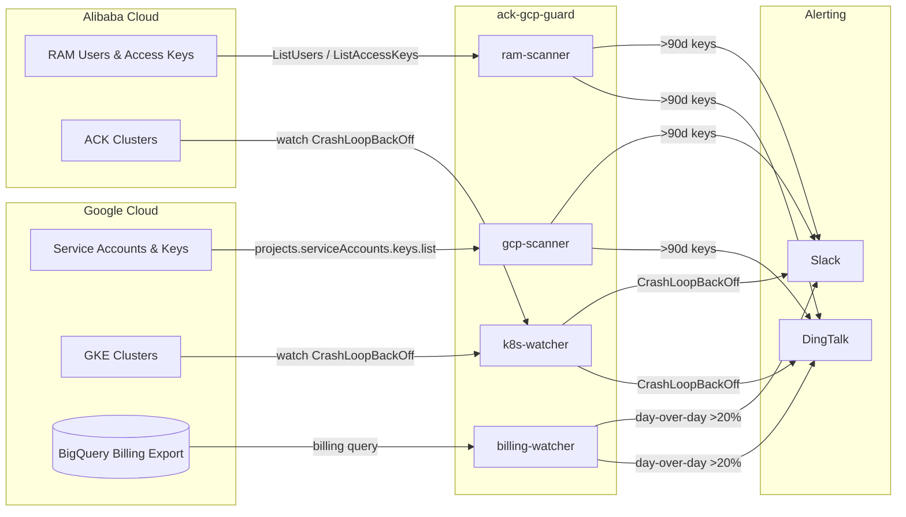

```
        █████╗  ██████╗██╗  ██╗    ██████╗  ██████╗██████╗ 
       ██╔══██╗██╔════╝██║ ██╔╝    ██╔══██╗██╔════╝██╔══██╗
       ███████║██║     █████╔╝     ██████╔╝██║     ██████╔╝
       ██╔══██║██║     ██╔═██╗     ██╔══██╗██║     ██╔═══╝ 
       ██║  ██║╚██████╗██║  ██╗    ██████╔╝╚██████╗██║     
       ╚═╝  ╚═╝ ╚═════╝╚═╝  ╚═╝    ╚═════╝  ╚═════╝╚═╝     
```

# ack-gcp-guard

> Production **cost & credential guard** for Alibaba Cloud ACK and Google Cloud GKE.
> Scans for stale cloud keys, watches CrashLoopBackOff pods, and alerts on billing spikes — across 50+ clusters.


---

## 🚨 The problem

If you run **50+ clusters** across Alibaba Cloud ACK and Google Cloud GKE, you have a
quiet, compounding security and cost leak:

- **Alibaba RAM key sprawl** — service accounts get access keys created once and forgotten.
  Rotated keys linger with full permissions. An attacker with one leaked key owns the account.
- **GCP Service Account key sprawl** — same story: `USER_MANAGED` keys older than 90 days
  are the #1 root cause of GCP credential leaks.
- **CrashLoopBackOff pods** — silently burning CPU, memory and money in ACK/GKE while nobody
  notices, because "the cluster is green".
- **Billing spikes** — a runaway job or a leaked key can double your cloud bill overnight.
  You find out 30 days later on the invoice, not in real time.
- **Alibaba OpenAPI throttling** — naive scanners hammer `ListUsers` / `ListAccessKeys` and get
  `Throttling.User` errors, then give up. This tool retries with exponential backoff.
- **GCP billing data** lives in BigQuery export tables — you need a watcher that queries them.

`ack-gcp-guard` solves all of that with three worker commands and a Kubernetes watcher.

---

## 🏗 Architecture



---

## ✨ Features

- 🔑 **`ram-scanner`** — lists Alibaba RAM users and flags **access keys older than 90 days**
  (configurable). Handles **Alibaba OpenAPI throttling** with retry + exponential backoff.
- 🔑 **`gcp-scanner`** — lists GCP Service Accounts and flags **`USER_MANAGED` keys older than
  90 days** via the IAM API.
- 💸 **`billing-watcher`** — queries the **GCP Billing BigQuery export** and alerts when a single
  day's spend is **>20% above the previous day**.
- 🚨 **`k8s-watcher`** — watches ACK/GKE pods in **CrashLoopBackOff** and posts to **Slack /
  DingTalk**.
- 🧱 **Terraform** modules to provision the exact least-privilege read-only access needed:
  `alibaba-ram` (RAM user + read-only key-scanning policy + STS role) and `gcp-billing`
  (Billing BigQuery export + read-only SA).
- 🔒 **No hardcoded credentials** — everything comes from environment variables.

---

## 🚀 Quickstart

### Prerequisites
- Go **1.22+**
- Terraform **~1.5**
- Cloud credentials (see below)

### Build
```bash
go build -o bin/guard ./cmd/guard
./bin/guard --help
```

### Run the scanners
```bash
# Alibaba RAM keys older than 90 days
ALIBABA_CLOUD_ACCESS_KEY_ID=xxx \
ALIBABA_CLOUD_ACCESS_KEY_SECRET=xxx \
./bin/guard ram-scanner --threshold-days 90

# GCP service account keys older than 90 days
export GOOGLE_APPLICATION_CREDENTIALS=/path/to/sa.json
export GCP_PROJECT_ID=my-project
./bin/guard gcp-scanner --threshold-days 90

# Billing spike watcher (>20% day-over-day)
export GCP_BILLING_DATASET=billing_export
export GCP_BILLING_TABLE=gcp_billing_export_v1_xxxx
./bin/guard billing-watcher --spike-pct 20
```

### Provision the infra
```bash
cd terraform
terraform init
terraform plan
terraform apply
```

---

## 🔐 Environment variables

| Variable | Required | Purpose |
|----------|----------|---------|
| `ALIBABA_CLOUD_ACCESS_KEY_ID` | ram-scanner | Alibaba access key ID |
| `ALIBABA_CLOUD_ACCESS_KEY_SECRET` | ram-scanner | Alibaba access key secret |
| `ALIBABA_CLOUD_REGION` | no | Default `cn-hangzhou` |
| `GOOGLE_APPLICATION_CREDENTIALS` | gcp/billing | Path to GCP SA key JSON |
| `GCP_PROJECT_ID` | gcp/billing | GCP project ID |
| `GCP_BILLING_DATASET` | billing-watcher | BigQuery billing dataset |
| `GCP_BILLING_TABLE` | billing-watcher | BigQuery billing table |
| `SLACK_WEBHOOK_URL` | no | Slack incoming webhook |
| `DINGTALK_WEBHOOK_URL` | no | DingTalk robot webhook |

---

## 🎬 Live demo

```text
$ ./bin/guard ram-scanner --threshold-days 90 --dry-run
[ram-scanner] scanning Alibaba RAM users (threshold: 90d)...
  ✗ user: deploy-bot  key: LTAI5t...  age: 412d  status: Active
  ✗ user: ci-runner   key: LTAI5t...  age: 203d  status: Active
  ✓ user: admin        key: LTAI5t...  age: 12d   status: Active
[ram-scanner] found 2 stale key(s) — rotate them now.

$ ./bin/guard billing-watcher --spike-pct 20 --dry-run
[billing-watcher] 2025-08-14: $1,204.00
[billing-watcher] 2025-08-15: $1,621.00  ▲ +34.6% ⚠ ALERT
```

> `--dry-run` prints what would be alerted without hitting webhooks — great for CI demos.

---

## 🧪 What's inside

```
├── cmd/guard/main.go              # Cobra CLI entrypoint
├── internal/
│   ├── scanner/ram.go             # Alibaba RAM key scanner (+ throttling retry)
│   ├── scanner/gcp.go             # GCP SA key scanner
│   └── billing/watcher.go         # BigQuery billing spike watcher
├── pkg/watcher/k8s_watcher.go     # CrashLoopBackOff watcher (Slack/DingTalk)
├── terraform/
│   ├── modules/alibaba-ram/       # RAM user + read-only policy + STS role
│   ├── modules/gcp-billing/       # Billing BigQuery export + read-only SA
│   ├── main.tf / variables.tf / outputs.tf / versions.tf
└── .github/workflows/ci.yml       # Go build + terraform fmt/validate
```

---

## 🛣 Roadmap / TODO (for Devin Bots)

- [ ] **Parallel execution** — run all three workers concurrently from one `guard run` command.
- [ ] `--json` output + machine-readable exit codes for CI.
- [ ] Unit tests with mocked SDK clients.
- [ ] Slack/DingTalk message templates with cluster context.
- [ ] Prometheus metrics endpoint.

---

## 📣 Follow progress

Building in public — follow the journey on X:
**[@si_juling](https://x.com/si_juling)**

---

## 📄 License

MIT — see [LICENSE](LICENSE).
